  

# Hey there! I'm Anirudh 👋

### Aspiring AI Engineer | Python Developer | Robotics Enthusiast

*Building intelligent systems, exploring AI, and turning ideas into reality.*

---

## 🧑‍💻 About Me

- 🎓 BE 2nd Year Student — Computer Science (AI & ML)
- 🤖 Passionate about Artificial Intelligence, Machine Learning and Robotics.
- 💻 Interested in Python programming, LLMs and building intelligent applications.
- 🧠 Exploring local AI models, semantic memory and AI-powered systems.
- 🚀 Focused on learning by building real-world projects.
- 🌱 Currently strengthening my DSA, AI/ML and software development fundamentals.

---

## ⚡ Tech Stack

### Programming Languages

### Web Technologies

### Tools & Platforms

### AI & Development Interests

`Artificial Intelligence` `Machine Learning` `LLMs` `Ollama` `Embeddings` `Robotics` `Embedded Systems` `Automation`

---

## 🚀 Featured Projects

### 1. PHONEX — Local AI Assistant

A personal local AI assistant designed to run on my own machine.

- Local LLM integration using Ollama.
- Qwen 2.5 model integration.
- Semantic memory using embeddings.
- Python-based desktop GUI.
- Memory management and retrieval.

**Tech:** Python · Ollama · Qwen 2.5 · Nomic Embeddings · Tkinter

### 2. AI-Based Quantum Learning Platform

An interactive learning platform designed to make quantum algorithms easier to understand.

- AI-powered tutoring.
- Interactive learning experience.
- Quiz-based learning.
- Exploring quantum computing concepts.

**Tech:** AI · Python · Web Development · Quantum Computing

### 3. Mockify — The Interview Agent

An interactive interview-preparation prototype with a React frontend and a separate Express/SQLite backend.

- Technical interview practice and sample coding challenges.
- Behavioural question practice and a virtual interview-room experience.
- Profile, skills, settings and interview-dashboard screens.
- Contextual, rule-based demo chat assistant.
- Express API endpoints for account signup, login and profile operations.

**Tech:** React · Vite · JavaScript · Node.js · Express · SQLite

🔗 **[View repository and source code](https://github.com/anirudhsrk07/The-interview-agent)**

### 4. Autonomous Navigation Robot

An intelligent robotics project focused on environmental sensing and navigation.

- Raspberry Pi-based system.
- Ultrasonic obstacle detection.
- TF Mini LiDAR integration.
- Autonomous navigation exploration.

**Tech:** Python · Raspberry Pi · LiDAR · Robotics

---

## 🧠 Currently Learning

- Artificial Intelligence & Machine Learning
- Data Structures and Algorithms
- Large Language Models
- Deep Learning fundamentals
- Robotics and Embedded Systems
- Building and experimenting with AI models

---

<h2 align="center">📊 GitHub Analytics</h2>

  
  

<h2 align="center">🐍 My Contribution Journey</h2>

  

---

## 🌐 Connect With Me

---

### 💡 "Learning. Building. Experimenting. Improving."

⭐ Thanks for visiting my profile!

