<h1 align="center">Hi 👋, I'm Anirudh Kulkarni</h1>
<h3 align="center">Aspiring AI Engineer & Robotics Enthusiast</h3>

---

### 👨‍💻 About Me  
- 🎓 BE 2nd Year Student — **CSE (AIML)**  
- 🤖 Interested in **coding, AI model building, hybrid robots**, and creative tech projects  
- 📧 Email: **anirudhsrk07@gmail.com**  
- 🌱 Currently learning **AI, ML, Data Structures, Robotics**  

---

### 🛠️ Skills  
- **Languages:** C (Basic), C++ (Basic), Python (Basic)  
- **Web:** HTML (Basic)  
- **Database:** SQL (Basic)  
- **Tech Interests:** Artificial Intelligence, Machine Learning, Robotics, Automation  

---

### 🚀 What I'm Working On  
- Strengthening fundamentals in **AI & ML**  
- Building small useful coding projects  
- Exploring **robotics and embedded systems**  
- Working toward building **my own AI models**  

---

### 🌐 Connect With Me  

---

### 📊 GitHub Stats

  
  

---

⭐ *Feel free to explore my repositories and follow my AI & Robotics journey!*
